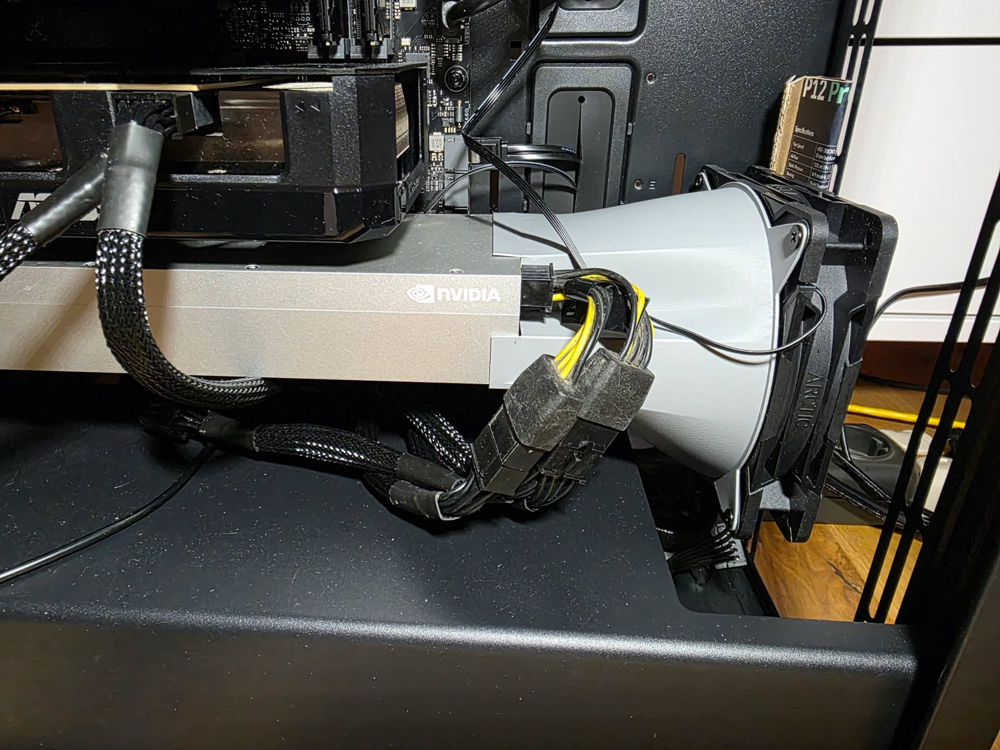
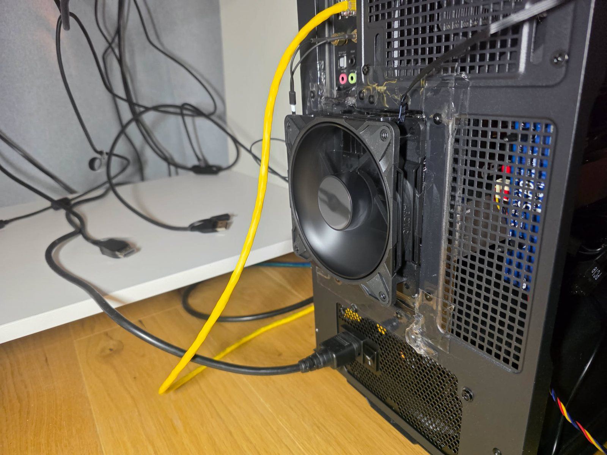
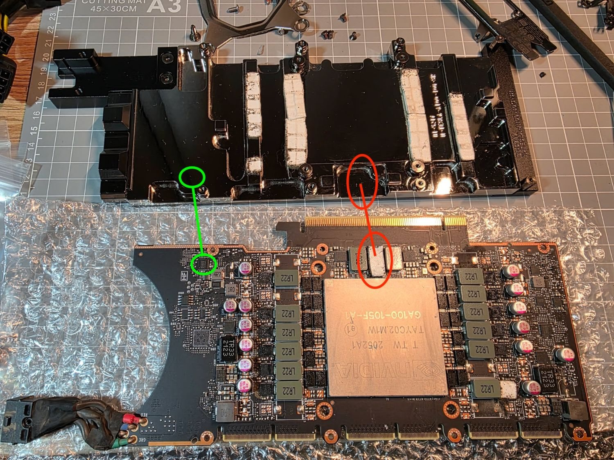
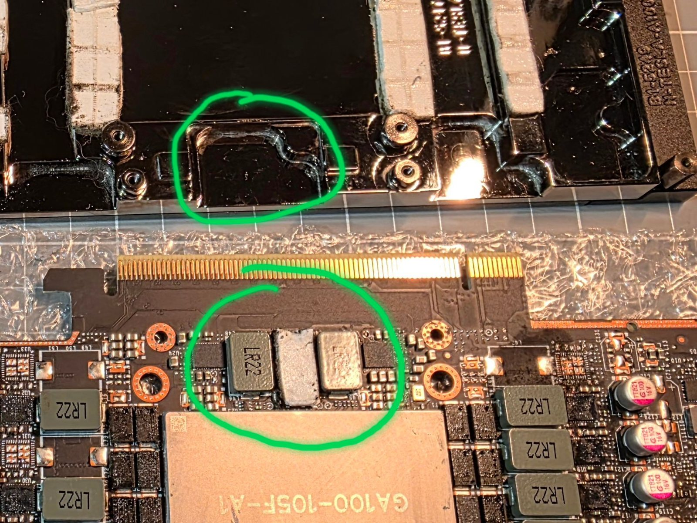
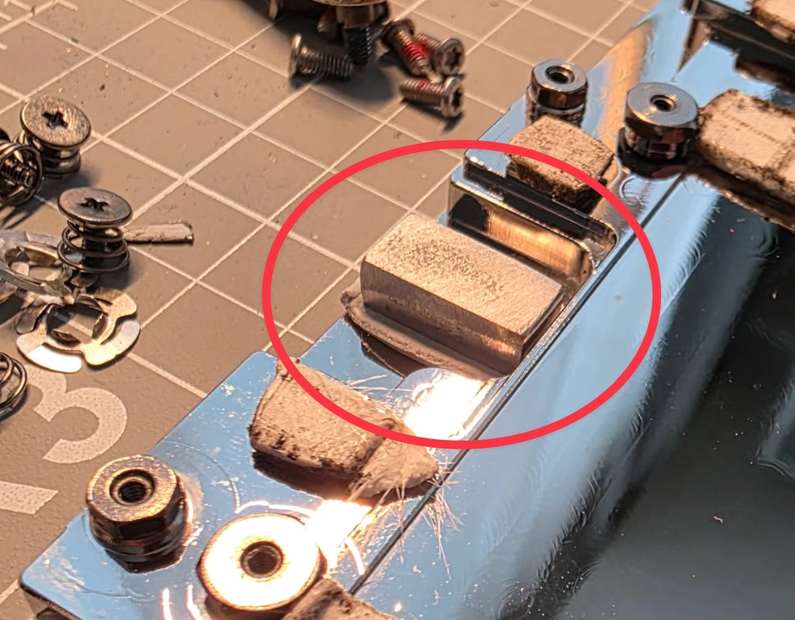
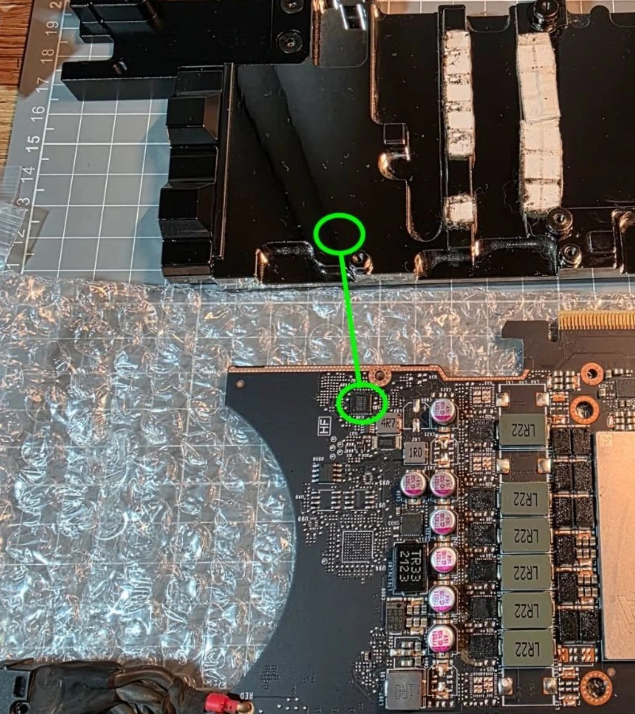
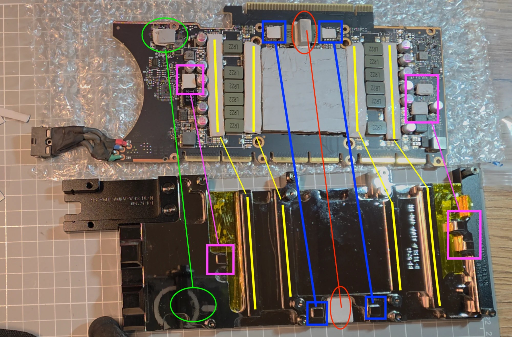
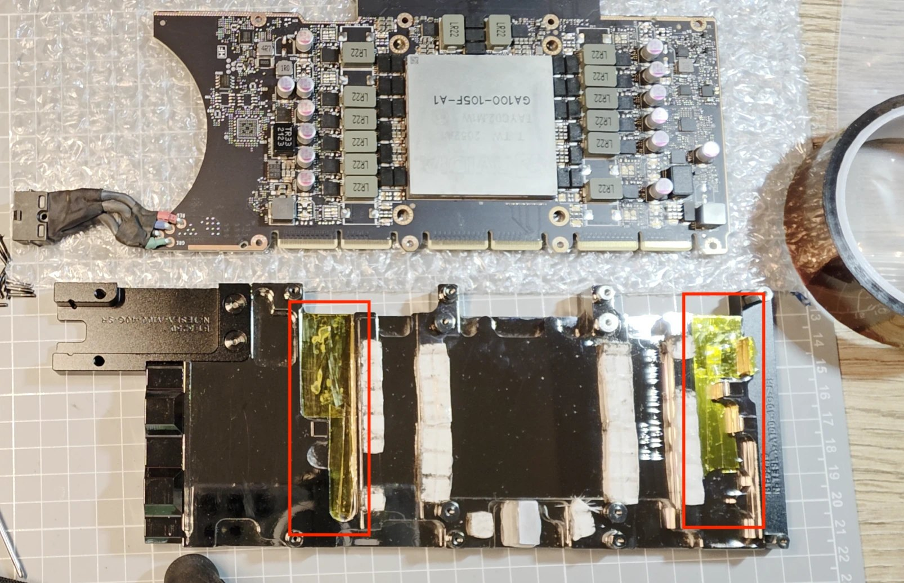

# Установка водоблока Bykski N-TESLA-A100-40G-SR на CMP 170HX

[English](fitment.md) · **Русский** · [← назад](../README.ru.md)

Блок подходит к карте почти идеально, но **два компонента не достают до поверхности блока в том виде, в каком он продаётся**, а выступов на блоке больше, чем описано в его инструкции.

> [!CAUTION]
> Всё токопроводящее рядом с работающей платой может её замкнуть. Прочитайте [предупреждения](#предупреждения) раньше, чем повторять идею с проставкой.

## Предыстория: воздушное охлаждение

До водоблока карта работала на воздухе. Вентилятор 120 мм с напечатанным на 3D-принтере переходником дул в карту, а второй вентилятор 120 мм стоял на задней стенке корпуса на выдув, все щели вокруг него были заклеены двусторонним наноскотчем, чтобы он тянул воздух через карту, а не из корпуса компьютера.

*Воздушное охлаждение: вентилятор 120 мм с переходником, напечатанным на 3D-принтере, дует в карту.*

*Воздушное охлаждение: второй вентилятор 120 мм закреплён на задней стенке корпуса на выдув, щели заклеены двусторонним наноскотчем.*

## Правило: прокладки подбираются по месту, а не по цифрам

Толщина прокладок из комплекта водоблока заранее неизвестна (это выбор производителя), поэтому всё ниже найдено примеркой.

- Приложите блок к карте с прокладками на чипах, снимите и посмотрите на каждую прокладку. Каждая должна показывать контакт с блоком.
- Контакт должен быть равномерным по всей карте. Чип без контакта перегревается.
- Крепёжные винты не должны напрягать карту. Если при затяжке карта изгибается или текстолит напрягается, где-то прокладка слишком толстая; карта должна лежать ровно.

## Мягкие термопрокладки из комплекта водоблока

Прокладки из комплекта водоблока были толщиной 1,7 мм и очень мягкие. Они сильно напоминают прокладки, которые стояли на карте с завода: обе карты, которые автор разбирал, имели целые заводские пломбы, то есть, судя по пломбам, до него их никто не вскрывал, и прокладки на обеих были одинаковые.

Ещё у автора был набор прокладок, купленный отдельно (марку он не помнит), и они оказались заметно жёстче. Мягкие выбраны намеренно: если где-то размер не угадан на доли миллиметра, мягкую прокладку проще продавить лёгким усилием, и все чипы получают контакт без изгиба карты и напряжения в текстолите. Жёсткие прокладки потребовали бы гораздо точнее подобранной толщины.

## Примерка: где водоблок не касается чипов видеокарты

Я наклеил старые термопрокладки на чипы, опустил блок и снова снял его. Прокладки, которые отлипли от чипов и прилипли к блоку, показывают, где есть контакт; прокладка, оставшаяся на чипе и не оставившая следа на блоке, показывает зазор. 

### Место 1: выемка в блоке над компонентом

*Блок (сверху) и карта (снизу) после примерки. Красным: компонент, прокладка которого не достала до блока. Зелёным: небольшая микросхема, где у блока плоский участок и зазор пришлось закрывать более толстой прокладкой.*

Компонент стоит между двумя дросселями со стороны разъёма PCIe от GPU. Прямо над ним в блоке большая выемка, поэтому прокладка осталась на чипе и до блока не доставала.

*Крупный план: выемка в блоке (сверху) и компонент на карте (снизу).*

**Как решил:** небольшая прямоугольная алюминиевая проставка (брусок), выпиленная из старого радиатора и подогнанная по размеру выемки. С обеих сторон приклеена термопрокладка, получается стопка: чип, прокладка, алюминиевый брусок, прокладка, блок.

*Алюминиевая проставка (красный овал) в выемке блока, вокруг видны остатки прокладок.*

**Как подобрал толщину:** она зависит от ваших прокладок, поэтому измеряйте на месте. Я напечатал на 3D-принтере заготовки того же размера с шагом толщины 0,5 мм, ставил каждую между прокладками, прикладывал блок к карте и оставил ту толщину, которая села лучше всего. Затем выпилил такую же деталь из алюминия. Площадь проставки в этой сборке 15 × 7 мм. **Заготовки готовы к печати: [stl/](../stl/README.ru.md).**

В моем случае толщина бруска получилась 5,5 мм + 2 термопрокладки по 1,7 мм сверху и снизу бруска. Но в вашем случае обязательно сделайте замеры, от этого многое зависит, например, чип не получит нормальное охлаждение, если толщины будет недостаточно. А если будет слишком большая толщина, то текстолит платы при нагреве может треснуть или повредятся слои внутри текстолита. В любом случае, не поленитесь, распечатайте бруски разных размеров и проведите примерку. Брусок лучше сделать из меди, но у меня был только алюминий :)

При подборе толщины учитывайте, что на ядре GPU будет термопаста, она тоже даст небольшую толщину. Для примерки я наклеил несколько полосок малярного скотча.

### Место 2: небольшая микросхема у края платы со стороны разъёма питания

Здесь у блока вообще нет выступа, просто плоская поверхность, поэтому зазор — это недостающая высота.

*Место 2: микросхема на карте (внизу) и плоский участок блока над ней (вверху), оба в зелёных кругах. Ни выемки, ни выступа. Нажмите, чтобы открыть крупнее.*

**Как решил:** две термопрокладки из комплекта водоблока, склеенные вместе (2х1.7мм). Проставка не понадобилась.

## Карта: совмещаем прокладки на карте с выступами на блоке

Каждая прокладка на карте (сверху) соединена линией с выступом или гребнем блока, с которым она соприкасается. Картинку можно открыть в полном размере кликом.

| Обозначение | Что это | Есть в инструкции блока? |
|---|---|---|
| жёлтые линии | длинные полосы прокладок вдоль рядов дросселей, встречаются с длинными гребнями блока | да |
| красный овал | компонент между двумя дросселями со стороны разъёма PCIe от GPU: место 1 выше (алюминиевая проставка с прокладками) | выемка есть, но одной прокладки не хватает: нужна проставка |
| синие квадраты | два небольших компонента по бокам от него, каждый встречается с небольшим выступом блока | да |
| лиловые квадраты | компоненты рядом с конденсаторами слева и справа, каждый встречается с выступом блока | **нет** (насколько помнит автор); прокладки добавлены всё равно |
| зелёный овал | небольшая микросхема у края платы со стороны разъёма питания: место 2 выше | выступа там **вообще нет**; использована двойная прокладка |

## Изоляция конденсаторов каптоновым скотчем

Читая о других сборках, автор встретил предупреждение, что некоторые компоненты карты могут касаться блока и замыкать. На глаз показалось, что конденсаторы местами могут касаться блока, поэтому эти две зоны блока (красные рамки на картинке) заклеены жёлтым каптоновым (полиимидным) скотчем. Это мера предосторожности по суждению автора; ничего не измерялось.

*Карта (сверху) и блок (снизу). Две красные рамки показывают зоны блока, заклеенные жёлтым каптоном.*

## Предупреждения

- **Алюминий проводит ток.** Проставка должна быть полностью изолирована прокладками с обеих сторон: прокладки больше проставки, никаких свесов и заусенцев металла, касающихся чего-либо ещё, и термопрокладки не должны проводить ток (лучше убедитесь, проверив мультиметром).
- **Составная прокладка проводит тепло хуже одинарной,** а у этих чипов я не нашёл показаний температуры (неизвестно), поэтому цифр для них нет. В этой сборке карта прошла `gpu_burn` на 250 Вт без ошибок и сброса частот, см. [калибровку](calibration.md); если можете, проверьте эти места контактным или ИК-термометром.
- **Измеряйте зазоры сами** до выбора толщины прокладки (см. [правило выше](#правило-прокладки-подбираются-по-месту-а-не-по-цифрам)): обжатие прокладки, её толщина и ревизия карты могут отличаться.

## Ещё предстоит написать

Полная пошаговая установка (разборка, паста, порядок затяжки, схема контура, проверка на протечки).

**На момент написания этого текста в комнате 23 °C, карта без нагрузки, ядро GPU 27 °C, память 45 °C, потребление карты 33 Вт. Вентиляторы крутятся на скорости 15% (750 об/мин). Помпа 30% (2842 об/мин).**
